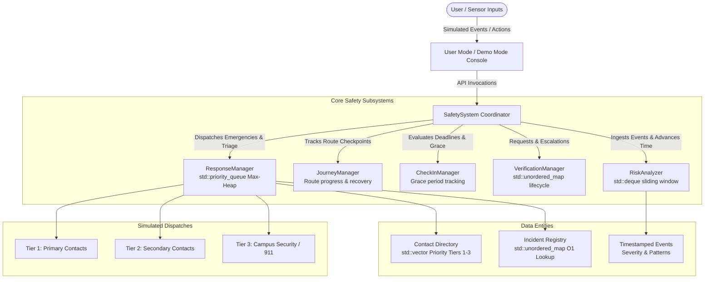
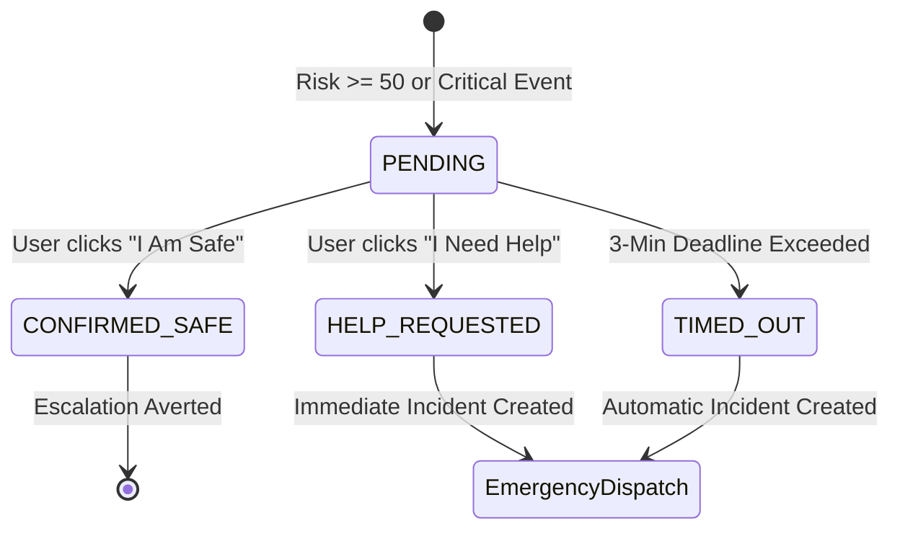
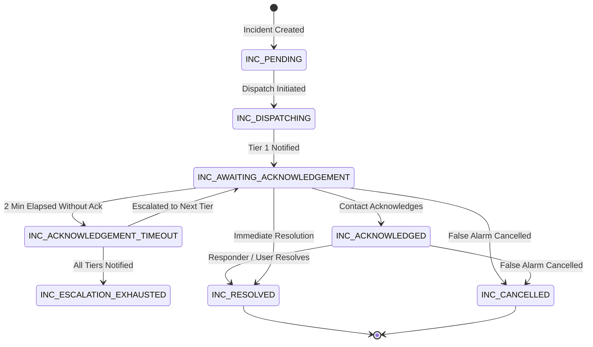
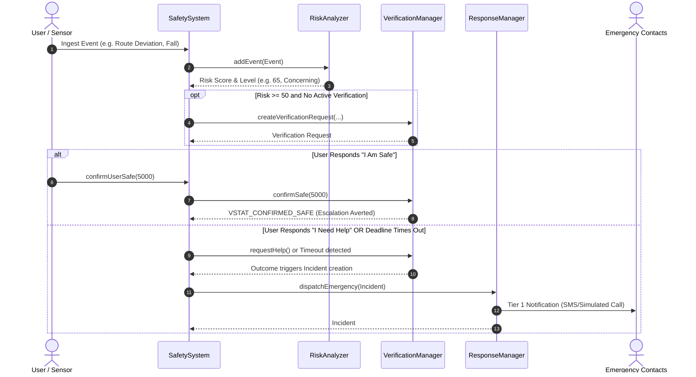

# SafeSignal — System Architecture & Design Specification

## 1. Executive Summary

SafeSignal is a mission-critical personal safety and incident management platform developed in C++ (C++11/C++17). It coordinates proactive danger detection, automated user safety verification, tiered emergency dispatch, and complete incident lifecycle auditing.

The system is designed around core Data Structures and Algorithms (DSA) principles to provide deterministic, highly predictable execution without external runtime dependencies or background thread race conditions.

---

## 2. High-Level System Architecture

SafeSignal follows an event-driven, coordinator-facade architecture anchored by the `SafetySystem` class:

---

## 3. Subsystem Breakdown

### 3.1 `SafetySystem` (Coordinator & Facade)
- **Role**: Coordinates all underlying managers, manages state transitions across modules, and maintains cross-module invariants.
- **Invariants**:
  - Exactly one emergency incident is created per verification request (`verificationToIncidentMap`).
  - Active emergency conflicts are prevented: while high-priority incidents are actively dispatching or awaiting acknowledgement, redundant verification requests are suppressed.
  - Critical sensor events (`SOS`, `Panic Button`, `Fall Detected`, `Impact`) immediately trigger safety verification or emergency dispatch, bypassing any prior safe-confirmation blackouts.
  - Natural completion of a journey at its final destination automatically cleans up associated check-ins.

### 3.2 `RiskAnalyzer` (Sliding-Window Scoring Engine)
- **Primary Data Structure**: `std::deque<TimestampedEvent>`
- **Algorithmic Mechanics**:
  - Maintains a configurable sliding time window (default: 10 minutes).
  - Enforces strict chronological order. Detects backward time jumps and handles multi-day/midnight rollovers using continuous absolute timeline tracking.
  - Prunes expired events from the front of the deque in amortized $O(1)$ time.
  - Computes composite risk scores:
    $$\text{Total Score} = \min(100, \text{Base Score} + \text{Frequency Bonus} + \text{Pattern Bonus})$$
  - Pattern recognition: Identifies dangerous sequences such as "Rapid Movement $\to$ Abrupt Stop", "Fall $\to$ Inaction", and "Deviation $\to$ Missed Check-in".

### 3.3 `JourneyManager` (Checkpoint Tracking & Route Deviation)
- **Primary Data Structure**: `std::vector<std::string>` (Planned Route)
- **Algorithmic Mechanics**:
  - Tracks progression through an ordered sequence of geographic checkpoints.
  - **Forward-Lookahead Recovery**: If a user reports a location that matches a future planned checkpoint, intermediate missed checkpoints are recognized as skipped without desynchronizing the remainder of the route.
  - Automatically identifies destination arrival and transitions the journey to completed status.

### 3.4 `CheckInManager` (Scheduled Safety Check-ins)
- **Primary Data Structure**: `std::vector<CheckIn>`
- **Algorithmic Mechanics**:
  - Allows users to schedule check-ins during an active journey.
  - Enforces a 5-minute grace period before a missed check-in is declared:
    $$\text{Deadline} = \text{Scheduled Time} + 5 \text{ minutes}$$
  - Distinguishes between on-time confirmations, late confirmations (after grace period), and missed deadlines.
  - Generates `Missed Check-in` events that feed directly into `RiskAnalyzer`.

### 3.5 `VerificationManager` (User Safety Verification)
- **Primary Data Structures**:
  - `std::unordered_map<int, VerificationRequest>` for $O(1)$ lookup and historical storage.
  - `std::vector<int>` for deterministic FIFO iteration over active pending request IDs.
- **Algorithmic Mechanics**:
  - Triggered when risk score reaches $\ge 50$ (Concerning threshold) or upon critical events.
  - Enforces a 3-minute user confirmation deadline.
  - Resolves into `VSTAT_CONFIRMED_SAFE`, `VSTAT_HELP_REQUESTED`, or `VSTAT_TIMED_OUT`.
  - Rejects duplicate pending requests while an active verification is in progress.

### 3.6 `ResponseManager` (Priority-Based Emergency Dispatch & Triage)
- **Primary Data Structures**:
  - `std::priority_queue<Incident>`: Max-heap sorting active emergencies by severity (1 to 5).
  - `std::unordered_map<int, Incident>`: Master registry for $O(1)$ lifecycle updates.
  - `std::vector<Contact>`: Tiered emergency contact directory.
- **Algorithmic Mechanics**:
  - **Tiered Escalation**:
    - **Tier 1** (Primary: Family, Roommate): Alerted immediately at $T=0$.
    - **Tier 2** (Secondary: Friends): Alerted at $T=2\text{ min}$ if Tier 1 has not acknowledged.
    - **Tier 3** (Campus Security, Police): Alerted at $T=4\text{ min}$ if Tier 2 has not acknowledged.
  - **Audit Trail**: Every notification and dispatch is immutably logged with timestamp, recipient, contact priority tier, and incident ID.

---

## 4. State Machines & Lifecycles

### 4.1 Verification Lifecycle

### 4.2 Incident Lifecycle

---

## 5. Event Ingestion to Dispatch Sequence

---

## 6. Algorithmic Complexity Matrix

| Operation | Method | Primary Container | Complexity |
|---|---|---|---|
| Ingest Safety Event | `RiskAnalyzer::addEvent` | `std::deque` | $O(1)$ amortized |
| Sliding Window Prune | `RiskAnalyzer::pruneExpiredEvents` | `std::deque` | $O(k)$ where $k \le \text{expired}$ |
| Calculate Risk Score | `RiskAnalyzer::analyzeRisk` | `std::unordered_map` | $O(w)$ where $w = \text{events in window}$ |
| Emergency Triage | `ResponseManager::processNextIncident`| `std::priority_queue` | $O(\log n)$ |
| Incident Lookup by ID | `ResponseManager::getIncidentByID` | `std::unordered_map` | $O(1)$ average |
| Verify Safe Confirmation | `VerificationManager::confirmSafe` | `std::unordered_map` | $O(1)$ average |
| Checkpoint Forward Match | `JourneyManager::updateLocation` | `std::vector` | $O(m)$ where $m = \text{checkpoints}$ |
| Check-in Time Evaluation | `CheckInManager::updateCurrentTime`| `std::vector` | $O(c)$ where $c = \text{check-ins}$ |

---

## 7. Dual-Mode Interface Design

SafeSignal features a single unified backend instance wrapped by two distinct presentation layers in `main.cpp`:

1. **User Mode (`runUserMode`)**:
   - Focuses on everyday, non-technical safety tasks.
   - Presents clean dashboards with color-coded safety indicators (🟢 / 🟡 / 🔴).
   - Provides step-by-step guidance for planning journeys and scheduling check-ins.
   - Offers one-touch SOS emergency help with automatic priority escalation.

2. **Demonstration Mode (`runDemonstrationMode`)**:
   - Technical interface preserving all **30 discrete system operations**.
   - Enables fine-grained inspection of queues, heaps, hash tables, and audit logs.
   - Supports rigorous demonstration and verification of all safety algorithms.

